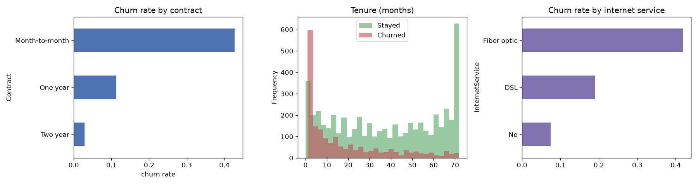
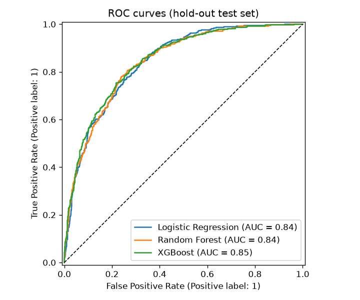
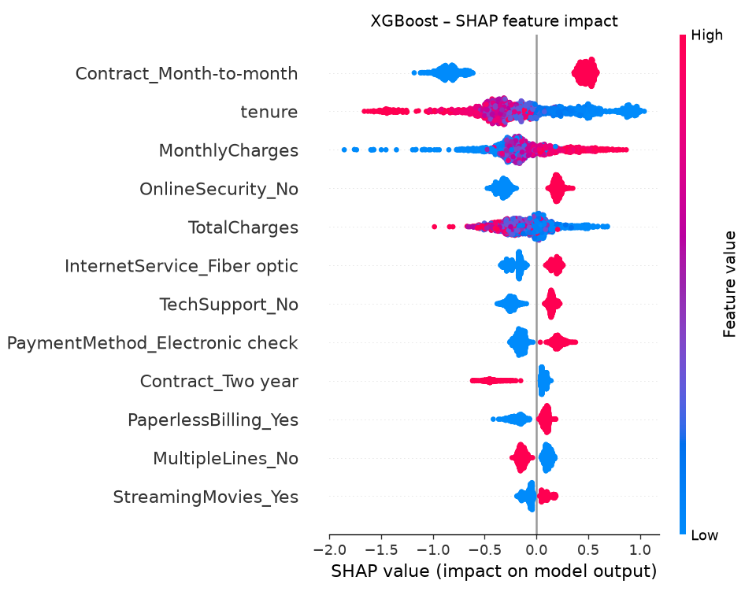
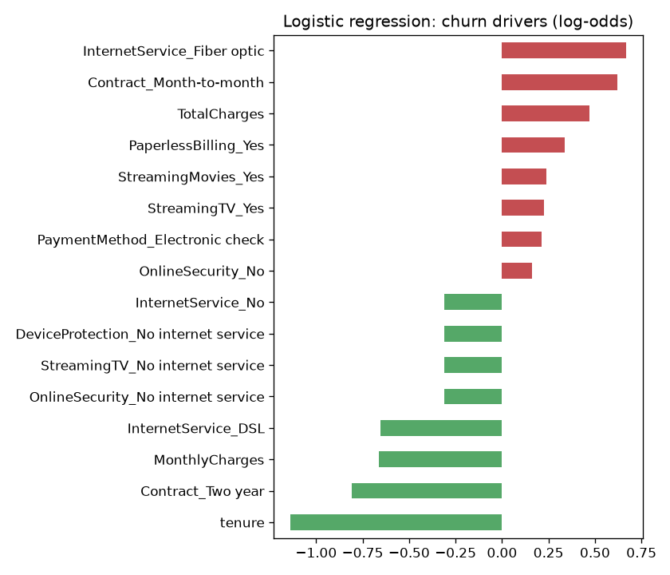

# Customer Churn Prediction (Telco)

Predict which telecom customers are likely to cancel, explain *why*, and turn the model into a retention plan.



## Problem
A subscription business loses **26.5 %** of its customers in the observed period. Retention offers are expensive, so the goal is to rank customers by churn risk and identify the drivers the business can act on.

**Data:** [IBM Telco Customer Churn](https://github.com/IBM/telco-customer-churn-on-icp4d) (public, 7,043 customers, 20 features: contract, services, billing, tenure). Copy in `data/telco_churn.csv`.

## Approach
1. **Cleaning** (`src/data.py`): `TotalCharges` coerced to numeric (11 blanks = brand-new customers → 0), target encoded 0/1.
2. **EDA** (`src/eda.py`): churn by contract, tenure and internet service.
3. **Preprocessing pipeline** (`src/features.py`): `ColumnTransformer` with scaling + one-hot encoding inside an sklearn `Pipeline` (no leakage during CV).
4. **Models** (`src/train.py`): Logistic Regression vs Random Forest vs XGBoost, class-imbalance handled with class weights; 5-fold stratified CV on 80 % training data, final evaluation on a 20 % hold-out set.
5. **Explainability:** logistic regression coefficients + SHAP values for XGBoost.

## Results (hold-out test set, n = 1,409)

| Model | CV ROC-AUC (5-fold) | Test ROC-AUC | Precision | Recall | F1 |
|---|---|---|---|---|---|
| Logistic Regression | 0.846 ± 0.012 | 0.842 | 0.50 | 0.78 | 0.61 |
| Random Forest | 0.845 ± 0.010 | 0.841 | 0.54 | 0.78 | 0.64 |
| **XGBoost** | **0.846 ± 0.011** | **0.846** | 0.52 | 0.79 | 0.63 |

All three models perform within CV noise, so the **simple, interpretable logistic regression is a perfectly valid production choice**. Its probability ranking means that **contacting the riskiest 20 % of customers reaches 50 % of all churners** (30 % → 65 %).



### What drives churn



- **Month-to-month contracts** churn at 42.7 % vs 11.3 % (1-year) and 2.8 % (2-year).
- **Low tenure**: risk is concentrated in the first months.
- **Fiber optic + high monthly charges**, **no online security / tech support**, and **electronic check** payment all raise risk.

## Business recommendations
1. **Contract migration:** offer a discount for switching month-to-month customers to 1-year plans, the strongest lever in the data.
2. **Onboarding programme** for the first 6 months (welcome call, check-ins).
3. **Bundle Online Security / Tech Support** free for 3 months for at-risk fiber customers.
4. **Nudge to automatic payment** (card / bank transfer) instead of electronic check.
5. **Score monthly** and send the top 20 % riskiest customers to the retention team.

## How to run
```bash
pip install -r requirements.txt
python -m src.train          # trains, evaluates, writes images/ and reports/
```
Outputs: `reports/model_comparison.csv`, `reports/metrics.json`, charts in `images/`.

## Project structure
```
src/data.py      loading & cleaning
src/features.py  preprocessing pipeline
src/eda.py       exploratory charts
src/train.py     training, CV, evaluation, SHAP
```
